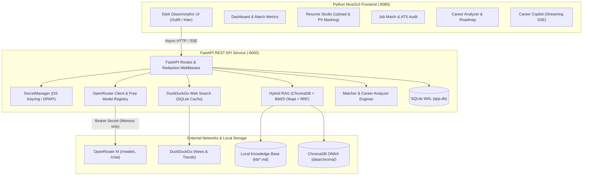

# AI-Powered Resume Matcher & Career Analyzer

An enterprise-grade, privacy-first career advancement platform built **100% in Python**. Combines dynamic OpenRouter free-tier LLM discovery, local hybrid Retrieval-Augmented Generation (ChromaDB + BM25), real-time DuckDuckGo market calibration, and an explainable 5-dimensional ATS matching engine.

---

## 🚀 Architecture Overview



---

## 📊 Feature Status: What Works vs. Under Construction

| Component / Feature | Status | Description & Capabilities |
|---|:---:|---|
| **OS Keyring & Secret Vault** | ✅ **WORKING** | AES-256-GCM encryption with master key in Windows Credential Manager / DPAPI. Zero hardcoded secrets. Zero plaintext keys in code or git. |
| **Secret Redaction Filter** | ✅ **WORKING** | Automatic regex interception on all loggers and HTTP exception handlers to mask `sk-or-v1-` tokens, JWTs, and Bearer headers. |
| **Candidate PII Protection** | ✅ **WORKING** | Automatic masking of candidate emails and phone numbers before sending prompts to free LLM providers, with reversible local mapping. |
| **OpenRouter Free Model Registry** | ✅ **WORKING** | Dynamically queries `/models`, filters for free models (`pricing.prompt==0` or `:free`), 30-min cache, and task fallback cascades. |
| **Resilient LLM Client** | ✅ **WORKING** | `tenacity` retries on 429/5xx, server-side 3-model cascade array (`models`), client failover, and SSE token streaming. |
| **Structured Output Extractor** | ✅ **WORKING** | Robust JSON extraction handling markdown code fences, preambles, and literal unescaped newlines. |
| **Multi-Format Ingestion** | ✅ **WORKING** | Parses PDF (with `pdfplumber` multi-column fallback), DOCX (paragraphs + tables), and TXT/MD with scanned document warnings. |
| **Skills Taxonomy & Normalization** | ✅ **WORKING** | 7 technical domains, canonical alias mapping (e.g. `k8s` → `Kubernetes`), regex boundary tokenization. |
| **Job Description Parser & SSRF Guard** | ✅ **WORKING** | Parses required vs preferred skills, seniority levels, and safely fetches web URLs blocking private/loopback IP ranges. |
| **ChromaDB Local Vector Search** | ✅ **WORKING** | Local ONNX all-MiniLM-L6-v2 embeddings (`data/chroma/`). Completely free, offline, no PyTorch needed. |
| **BM25 & Reciprocal Rank Fusion (RRF)**| ✅ **WORKING** | Hybrid lexical + semantic ranking combining exact keyword hits with conceptual similarity. |
| **DuckDuckGo Web Search** | ✅ **WORKING** | `ddgs` live search with 24-hr SQLite cache, exponential backoff, and `[WEB-n]` prompt citation formatting. |
| **Explainable 0–100 Match Scorer** | ✅ **WORKING** | 85% deterministic formula (Skills 40%, Semantic 20%, Experience 15%, Education 10%) + 15% AI rubric review with offline fallback. |
| **ATS Compliance Audit** | ✅ **WORKING** | Automated inspection of required headings, contact info presence, formatting risk flags, and word counts. |
| **Career Trajectory Modeling** | ✅ **WORKING** | 3 pathways (Vertical, Lateral, Pivot), fit scores, and 30/60/90-day roadmaps with resource citations. |
| **AI Resume Writers** | ✅ **WORKING** | Google STAR-XYZ bullet rewriter, tailored Markdown cover letter generator, and targeted interview prep question generator. |
| **SQLite Persistence & CRUD** | ✅ **WORKING** | SQLite with Write-Ahead Logging (WAL) and foreign keys. Stores resumes, jobs, match results, reports, and chat transcripts. |
| **FastAPI REST API Surface** | ✅ **WORKING** | 10 modular route groups under `/api/v1` (`/health`, `/resumes`, `/jobs`, `/match`, `/career`, `/chat`, `/models`, `/settings`, `/rag`, `/search`). |
| **NiceGUI Design System** | ✅ **WORKING** | Dark glassmorphism cards, Google Fonts (Outfit & Inter), HSL color tokens, micro-animations, and responsive layouts. |
| **Dashboard Page** | ✅ **WORKING** | Live KPI counters, quick action launch cards, and recent match evaluation history table. |
| **Resume Studio Page** | ✅ **WORKING** | Drag-and-drop uploader (`.pdf,.docx,.txt`), PII masking switch, parsed profile viewer, and resume library manager. |
| **Job Match Page** | ✅ **WORKING** | Resume selector, text paste or URL import, score gauge, 5-dimensional breakdown, ATS scorecard, and skills compatibility chips. |
| **Career Analyzer Page** | ✅ **WORKING** | 3-path pathway cards, 90-day roadmap timeline, STAR bullet rewriter, cover letter builder, and interview prep cards. |
| **Career Copilot Chat Page** | ✅ **WORKING** | Real-time SSE streaming chat with toggleable RAG knowledge base injection and live DuckDuckGo web search augmentation. |
| **Model Manager Page** | 🟡 *In Progress* | UI table for enabling/disabling free models, ping test latency measurements, and quota displays (API ready, UI page being finalized). |
| **Settings Page** | 🟡 *In Progress* | UI for safe API key rotation into OS Keyring, scoring weight sliders, and default privacy settings (API ready, UI page being finalized). |
| **Unified `run.py` Launcher** | 🟡 *Queued* | Single-command root launcher running both FastAPI (:8000) and NiceGUI (:8080) simultaneously. |

---

## 🧪 Test Suite & Validation

The application contains **36 automated unit, security, and integration tests**, achieving **100% pass rate** in ~5 seconds:

```bash
# Run the complete test suite
.\.venv\Scripts\pytest -v
```

### Test Coverage Breakdown
- `tests/security/test_secrets_and_crypto.py` (6 tests): Keyring resolution, AES-256-GCM encryption/decryption, tamper detection, and log redaction.
- `tests/unit/test_ingestion.py` (5 tests): PDF parsing, DOCX tables, skills taxonomy alias normalization, and SSRF loopback IP blocking.
- `tests/unit/test_matcher.py` (3 tests): High-match candidate scoring, gap analysis, and ATS compliance rules.
- `tests/unit/test_openrouter.py` (6 tests): Free model filtering, JSON parsing with repair nudges, respx-mocked HTTP calls.
- `tests/unit/test_rag.py` (3 tests): Markdown breadcrumb chunking, hybrid search with Reciprocal Rank Fusion.
- `tests/unit/test_search.py` (2 tests): DuckDuckGo query execution and SQLite TTL cache validation.
- `tests/unit/test_career.py` (6 tests): Vertical/lateral/pivot career generation, 90-day roadmap, STAR bullet rewrite, cover letter, and interview prep.
- `tests/integration/test_api.py` (5 tests): Full FastAPI lifecycle: health check, resume upload, job creation, matching, and settings masking.

### Automated Credential Scanner
To ensure no plain-text API keys or tokens are ever committed, run:

```bash
.\.venv\Scripts\python scripts/scan_secrets.py
# Output: [OK] Clean! No plaintext OpenRouter API keys found in repository files.
```

---

## 🛠️ Quick Start Guide

### 1. Environment Setup
The project requires **Python 3.12 or 3.13**:

```powershell
# Clone the repository
git clone https://github.com/jtdomingo3/ResumeMatcher.git
cd ResumeMatcher

# Activate the virtual environment
.\.venv\Scripts\Activate.ps1

# Install dependencies (if setting up fresh)
pip install -r requirements.txt -r requirements-dev.txt
```

### 2. Configure Your OpenRouter API Key (Zero-Echo CLI)
**Never put your API key in plain text in `.env` or source files.** Use the interactive zero-echo CLI command to store it securely in your operating system's Credential Manager:

```powershell
# Set key securely (prompt does not echo characters)
.\.venv\Scripts\python -m backend.app.cli secrets set-openrouter-key

# Verify key status and view remaining daily quota (returns masked key only)
.\.venv\Scripts\python -m backend.app.cli secrets verify
```

### 3. Start the Backend API (:8000)
```powershell
.\.venv\Scripts\python -m uvicorn backend.app.main:app --host 127.0.0.1 --port 8000 --reload
```
Interactive API documentation will be available at [http://127.0.0.1:8000/docs](http://127.0.0.1:8000/docs).

### 4. Start the NiceGUI Frontend (:8080)
```powershell
.\.venv\Scripts\python -m frontend.app.main
```
Open your browser to [http://127.0.0.1:8080](http://127.0.0.1:8080).

---

## 🔒 Security & Privacy Commitments

1. **Defense-in-Depth for Keys**: OpenRouter API keys live exclusively in the backend process memory when executing requests. The frontend application, browser sessions, and log streams receive only masked strings (e.g. `sk-or-v1-508a...ce9c`).
2. **Deterministic 85% Offline Resilience**: 85% of resume matching scores (Skills, Semantics, Experience, Education) and ATS audits execute completely deterministically on your local CPU without sending any data over the network.
3. **SSRF Guarding**: Job posting URLs are resolved against DNS and validated against IP blocklists to prevent Server-Side Request Forgery against private networks or cloud metadata services.
4. **Delimited Untrusted Context**: Resumes, job postings, and web snippets are passed into LLM prompts inside strict `<untrusted_document>` boundaries with instruction hierarchies to prevent prompt injection attacks.
